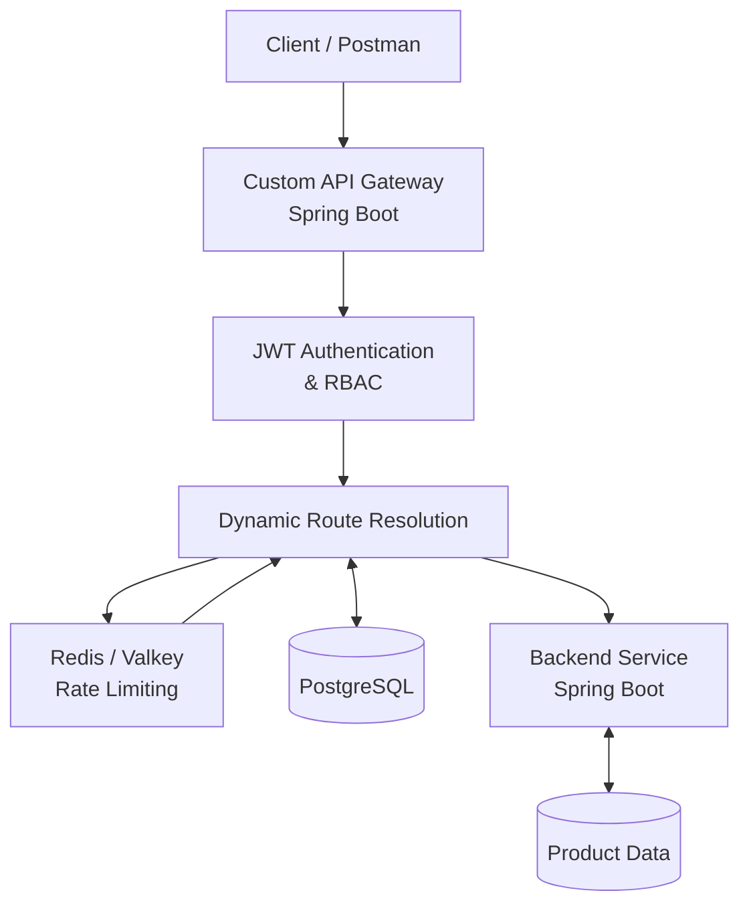

# 🚀 Custom API Gateway

A secure, configurable API Gateway built with **Java and Spring Boot** that provides centralized request routing, JWT authentication, role-based access control, Redis-based rate limiting, and request correlation across backend services.

The project consists of two independent Spring Boot applications: an API Gateway and a backend service. PostgreSQL stores application data and dynamic route configurations, while Redis/Valkey supports rate limiting.

## 📌 Project Overview

In a microservices architecture, clients often need to communicate with multiple backend services. Managing authentication, routing, and traffic limits independently across these services can become complex.

This project introduces a centralized API Gateway that receives client requests, authenticates users where required, resolves configured routes, enforces traffic limits, and forwards requests to the appropriate backend service.

### Key Objectives

- Centralize API request routing.
- Implement JWT-based authentication.
- Enforce role-based authorization for administrative operations.
- Support dynamically configurable routes.
- Protect backend services using rate limiting.
- Track requests using correlation IDs.
- Handle errors and return appropriate HTTP responses.
- Deploy the application components independently.

## ✨ Features

### 1. JWT Authentication
- User registration and login.
- JWT generation after successful authentication.
- Authentication for protected endpoints.
- Validation of incoming authentication credentials.

### 2. Role-Based Access Control (RBAC)
- Support for `ADMIN` and `USER` roles.
- Administrative privileges for route management.
- Restriction of route creation to authorized administrators.
- Unauthorized requests receive appropriate HTTP responses.

### 3. Dynamic Routing
- Create routes through an API endpoint.
- Store route configurations in PostgreSQL.
- Resolve incoming requests against configured routes.
- Forward requests to their configured backend targets.
- Validate target URLs before forwarding requests.

### 4. Redis-Based Rate Limiting
- Restrict the number of requests allowed within a configured time window.
- Use Redis/Valkey for rate-limit state.
- Return rate-limit information through HTTP response headers.
- Reject excess requests when the configured limit is exhausted.

Example response headers:

```http
X-RateLimit-Limit: 5
X-RateLimit-Remaining: 4
```

When the limit is exceeded, the gateway returns a rate-limit error.

### 5. Correlation IDs
- Associate requests with correlation IDs.
- Include correlation IDs in gateway logs.
- Return correlation IDs in HTTP response headers.
- Make request tracing and troubleshooting easier.

### 6. Backend Request Forwarding
- Forward client requests through the gateway to configured backend services.
- Support GET, POST, PUT, PATCH, and DELETE forwarding.
- Propagate appropriate request headers.
- Return backend responses through the gateway.

### 7. Centralized Error Handling
- Handle authentication and authorization failures.
- Return appropriate HTTP status codes.
- Provide rate-limit error responses.
- Support troubleshooting through application logs and correlation IDs.

## 🏗️ Architecture



### Request Flow

1. The client sends an HTTP request to the API Gateway.
2. The gateway applies the relevant authentication and authorization rules.
3. The gateway resolves the configured route using PostgreSQL.
4. Rate limiting is applied using Redis/Valkey.
5. The gateway forwards the request to the appropriate backend endpoint.
6. The backend processes the request and accesses its data.
7. The gateway returns the response to the client with relevant headers.

**Note:** The exact processing order depends on the configured security filters and request-handling implementation.

## 🛠️ Technology Stack

| Technology | Purpose |
|---|---|
| Java 17 | Programming language and runtime |
| Spring Boot | Application framework |
| Spring Security | Authentication and authorization |
| JWT | Token-based authentication |
| Spring Data JPA | Database persistence |
| PostgreSQL | Relational database |
| Redis / Valkey | Rate limiting |
| Maven | Dependency management and build automation |
| Docker | Containerization |
| Docker Compose | Local multi-service setup |
| Git & GitHub | Version control and source management |
| Render | Cloud deployment |
| Postman | API testing |

## 📂 Repository Structure

```text
custom-api-gateway/
│
├── backend-service/
│   ├── Dockerfile
│   └── src/
│
├── custom-api-gateway/
│   ├── Dockerfile
│   └── src/
│
├── database/
│   └── migration/
│       └── V1__create_initial_schema.sql
│
├── docker-compose.yml
│
└── README.md
```

### Components

| Component | Responsibility |
|---|---|
| `custom-api-gateway/` | Gateway endpoints, security, routing, and request forwarding |
| `backend-service/` | Backend APIs and product operations |
| `database/migration/` | SQL schema initialization |
| `docker-compose.yml` | Local service orchestration |
| `README.md` | Overall project documentation |

The gateway and backend are separate Spring Boot applications and can be built and deployed independently.

## 🌐 Deployment

The application components are deployed on Render.

| Service | Deployment URL |
|---|---|
| API Gateway | https://custom-api-gateway.onrender.com |
| Backend Service | https://backend-service-rbe0.onrender.com |

### Health Check

Check the gateway's health endpoint:

```http
GET https://custom-api-gateway.onrender.com/actuator/health
```

Expected response:

```json
{
  "status": "UP"
}
```

The deployment uses environment variables to configure database connections, Redis/Valkey, JWT signing, and other application settings.

**Deployment note:** The current deployment uses Render's free-tier resources for testing and demonstration. Free-tier services may experience cold starts or resource limitations.

## 🔌 API Endpoints

The following examples describe the endpoints verified during deployment and testing. Other backend operations depend on the application's controller implementation.

### 1. Register a User

```http
POST /auth/register
Content-Type: application/json
```

Example request:

```json
{
  "username": "testuser",
  "password": "YourStrongPassword"
}
```

Newly registered users receive the `USER` role.

### 2. Login

```http
POST /auth/login
Content-Type: application/json
```

Example request:

```json
{
  "username": "admin",
  "password": "YOUR_ADMIN_PASSWORD"
}
```

A successful login returns a JWT token.

Use the token in subsequent requests where authentication is required:

```http
Authorization: Bearer YOUR_JWT_TOKEN
```

Keep tokens and passwords private.

### 3. Create a Dynamic Route

```http
POST /routes
Authorization: Bearer YOUR_ADMIN_JWT
Content-Type: application/json
```

Example request:

```json
{
  "path": "/products",
  "targetUrl": "https://backend-service-rbe0.onrender.com"
}
```

Example response:

```json
{
  "id": 1,
  "path": "/products",
  "targetUrl": "https://backend-service-rbe0.onrender.com"
}
```

Route creation requires an authenticated administrator.

### 4. Retrieve Products Through the Gateway

```http
GET /products
```

Full deployed URL:

```text
https://custom-api-gateway.onrender.com/products
```

Example response:

```json
[
  {
    "id": 1,
    "name": "Laptop",
    "price": 55000.0
  }
]
```

This demonstrates request forwarding through the gateway to the backend service.

### 5. Retrieve Products Directly From the Backend

```http
GET https://backend-service-rbe0.onrender.com/products
```

This endpoint can be used to compare direct backend behavior with gateway-mediated requests.

## 🔐 Security and Authorization

The project implements JWT authentication and role-based authorization.

| Scenario | Expected Result | Verified |
|---|---|---|
| Successful login | JWT returned | Yes |
| Access protected endpoint without a token | `401 Unauthorized` | Yes |
| Attempt route creation with a `USER` token | `403 Forbidden` | Yes |
| Create a route with an authorized `ADMIN` token | Successful response | Yes |

### HTTP Status Codes

- **200 OK:** Request completed successfully.
- **401 Unauthorized:** Authentication is missing or invalid.
- **403 Forbidden:** The authenticated user does not have the required permissions.
- **429 Too Many Requests:** The rate limit has been exceeded.
- **502 Bad Gateway:** The gateway encountered an unsuccessful upstream request or forwarding failure.

Target URL validation is also included to help restrict requests to permitted backend targets.

## 🚦 Rate-Limiting Example

The deployed gateway was tested with a configured limit of five requests per rate-limit window.

Example response headers:

```http
X-RateLimit-Limit: 5
X-RateLimit-Remaining: 4
```

After exhausting the available request capacity, additional requests are rejected until capacity becomes available again.

Example error:

```text
Too many requests. Please try again later.
```

This helps prevent excessive traffic from overwhelming backend services.

## 🗄️ Database Schema

The project uses PostgreSQL with three primary tables.

| Table | Purpose |
|---|---|
| `users` | Stores user accounts, encoded passwords, and roles |
| `route` | Stores dynamic route paths and target URLs |
| `product` | Stores product records |

### Route Table

The `route` table stores the information required for dynamic routing.

Important fields:

- `id`: Unique route identifier.
- `path`: Incoming API path.
- `target_url`: Configured backend target URL.

### Users Table

The `users` table stores account information and authorization roles.

Passwords should be stored as encoded password hashes, never as plaintext.

### Product Table

The `product` table stores product records, including their IDs, names, and prices.

The initial database schema is provided in:

```text
database/migration/V1__create_initial_schema.sql
```

## 💻 Running the Project Locally

### Prerequisites

Install the following:

- Java 17
- Maven, or use the included Maven Wrapper if available
- Docker and Docker Compose
- Git

### 1. Clone the Repository

```bash
git clone https://github.com/DKMohan111/custom-api-gateway.git
cd custom-api-gateway
```

### 2. Configure Environment Variables

Configure the required environment variables for the gateway and backend services.

Typical settings include:

```text
SPRING_DATASOURCE_URL
SPRING_DATASOURCE_USERNAME
SPRING_DATASOURCE_PASSWORD
SPRING_DATA_REDIS_HOST
SPRING_DATA_REDIS_PORT
JWT_SECRET
APP_ADMIN_PASSWORD
GATEWAY_ALLOWED_TARGETS
```

Configure only the variables required by each application.

Use strong secrets for JWT signing and administrative credentials. Never commit passwords, tokens, or production environment files to GitHub.

### 3. Start the Supporting Services

If the root Docker Compose configuration defines PostgreSQL, Redis/Valkey, and both applications, start the configured services with:

```bash
docker compose up --build
```

Alternatively, start the database and Redis/Valkey separately, then launch the two Spring Boot applications using their respective project configurations.

### 4. Verify the Deployment

Check the gateway health endpoint:

```http
GET http://localhost:8080/actuator/health
```

Test the backend directly:

```http
GET http://localhost:8081/products
```

Then test request forwarding through the gateway:

```http
GET http://localhost:8080/products
```

Ensure the configured route and target URL match your local service configuration.

**Note:** The exact environment variables, Docker Compose settings, and application startup commands must match the configuration files in the repository.

## 🧪 Testing

The project has been tested locally and through the deployed services.

### Automated Tests

The local test suite previously completed with:

| Application | Tests Passed |
|---|---:|
| Backend Service | 9 |
| Custom API Gateway | 91 |
| **Total** | **100** |

### Deployed Integration Tests

The following behaviors were verified through Postman:

- Gateway health check returns `UP`.
- User registration and JWT login work.
- An administrator can create a dynamic route.
- A normal user receives `403 Forbidden` when attempting to create a route.
- Requests without a required JWT receive `401 Unauthorized`.
- Product requests are forwarded successfully through the gateway.
- PostgreSQL product data is returned through the gateway.
- Rate limiting rejects excess requests.
- Rate-limit headers and correlation IDs are returned.

## 🔮 Future Improvements

Potential enhancements include:

- Support for additional backend services.
- Improved route management and route update/delete operations.
- Configurable rate limits per user or route.
- Centralized observability and metrics dashboards.
- Improved distributed tracing.
- More comprehensive integration and load testing.
- Automated deployment pipelines.
- Production-grade secrets management.
- Persistent, production-ready infrastructure and database backups.

These are potential future enhancements, not claims about currently implemented functionality.

## 👨‍💻 Author

**D K Mohan**

GitHub: [DKMohan111](https://github.com/DKMohan111)

